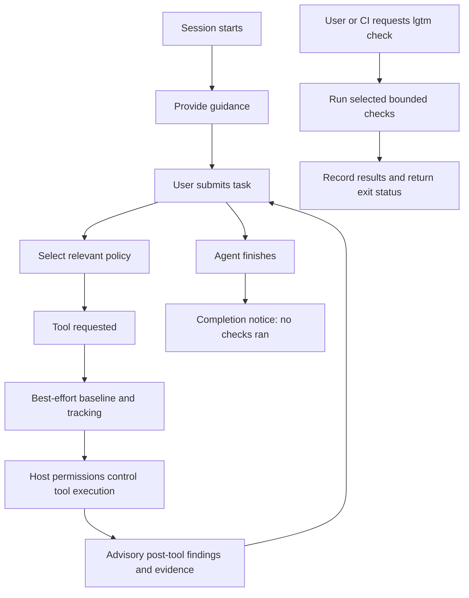

# LGTM

`lgtm` adds engineering guidance, edit feedback, and on-demand checks to agent workflows. Automatic hooks observe work; they do not deny tools, intercept commits, or block completion.

**Observer-only hooks start with v0.15.0.** Run `lgtm update` to upgrade the
binary and refresh registered managed hooks, then reload or restart running
agents. Editing this checkout alone does not change installed hooks.

The current release supports Python, TypeScript/JavaScript, Rust, Go, shell,
Terraform, JVM, C#, C/C++, SQL, and mixed repositories on x86_64 Linux and macOS.

## Quick Install

Linux and macOS:

```bash
curl -fsSL https://raw.githubusercontent.com/tcbuilds/lgtm/main/scripts/install.sh | sh
lgtm --version
```

This downloads the latest release, verifies its SHA-256 checksum, and installs `lgtm` to `~/.local/bin`. Add that directory to `PATH` if needed:

```bash
echo 'export PATH="$HOME/.local/bin:$PATH"' >> ~/.bashrc # or ~/.zshrc
```

To install from source instead, use Rust:

```bash
cargo install --git https://github.com/tcbuilds/lgtm
```

## Initialize a Project

From the Python repository you want to protect:

```bash
lgtm init
lgtm doctor
```

`lgtm init` adds the project configuration and Claude Code hooks without replacing existing settings. It also merges the official LSP plugin enablement and protected-file permission entries into `.claude/settings.json`; explicit user plugin disablement and unrelated permission rules remain unchanged. `lgtm doctor` shows any optional checking tools you still need to install, including `gitleaks`, `ruff`, and `semgrep`. It also scans the repository's bounded workspace tree and reports advisory, repository-relevant language servers (such as `rust-analyzer`, `gopls`, or `clangd`). These recommendations never run a server or install anything; missing servers do not affect the doctor's successful exit. JVM projects receive a coarse Java/JVM recommendation and may need a separate Kotlin language server.

Init keeps an empty `.lgtm/execpolicy.json` compatibility marker. Existing files
are preserved, but LGTM no longer uses their command or path lists to deny work.
Host-agent permissions and sandbox settings remain separate and unchanged.

Commit the generated configuration and hook wiring when it is ready.
Future sessions receive guidance and advisory edit feedback. Commits use ordinary
Git commands, without an LGTM approval transaction or special shell syntax.
See the [Claude adapter](doc/adapters/claude.md),
[Pi adapter](doc/adapters/pi.md), and
[observer-hook decision](doc/adr/0017-observer-hooks-and-explicit-checks.md).

For Pi, run:

```bash
lgtm init --agent pi
```

Pi init writes the LGTM extension under `.pi/extensions/`, merges unpinned Pi package defaults into `.pi/settings.json`, and merges the configured language-server routes into `.pi/pi-lsp.json`. The defaults include web search, GitHub PR status, and goal support. Init and refresh remove only the exact old version pins shipped by LGTM; other package versions, package filters, settings, timeouts, and named server routes are preserved. Run `pi update --extensions` to download newer packages; `lgtm update` changes declarations, not installed npm packages. After the project is trusted, Pi loads the extension and installs missing configured packages through its normal package flow. Language-server executables are not installed by LGTM or pi-lsp; use `/lsp` and `lgtm doctor` to identify missing commands.

The binary also embeds the global Jev auto router and its gates helper. Init, update, and refresh install the pair under `~/.pi/agent/extensions/jev-auto/`; no source checkout or manual copy is required. Reload Pi after installation. Routing can use the configured classifier; CLI installation itself makes no model call. See [Jev auto setup and ownership](doc/jev-auto.md#install-and-verify).

Pi packages and project extensions execute with the user's permissions. Review the generated files before trusting the project. Roll back by removing only LGTM's extension and generated package/server entries; do not delete either JSON file when it also contains user configuration.

To take the standards as guidance with no enforcement hooks, use `lgtm init --rules-only`. It writes `.claude/rules/` for Claude Code and Pi, or the concatenated `AGENTS.md` document with `--agent codex`. Shipped rule files are refreshed on init; changed files are saved once beside the rule as `<rule>.<sha256>.bak`, while custom filenames and Codex `AGENTS.md` content are preserved.

## Initialize All Harnesses Globally

Install every harness supported by this LGTM build under your home directory:

```bash
lgtm init -g
```

Global init writes or merges `$HOME/.claude/settings.json`, installs the rule
documents under `$HOME/.claude/rules/`, writes or merges
`$HOME/.codex/hooks.json`, and adds an LGTM-managed section to
`$HOME/.codex/AGENTS.md`. Existing hooks and instruction text are preserved.
It does not create repository `.lgtm` configuration; run normal `lgtm init`
inside each repository that needs project commands, overrides, or execpolicy.

Preview global writes without changing files with `lgtm init -g --dry-run`.
Codex requires reviewing changed command hooks through `/hooks` before they run.

## How the Hooks Work

The `lgtm` binary provides guidance, observations, and explicit checks. It is not a background service.
The repository's `.claude/settings.json` tells Claude Code when to start it:

```text
Claude event
    ↓
.claude/settings.json hook
    ↓
lgtm hook <event>
    ↓
select relevant rules → guide the agent → observe changes → report findings
```

At the start of a session, LGTM gives the agent a small permanent contract.
When you submit a task, it selects only the relevant standards and sends a
compact MUST/REVIEW packet before coding begins. Before a tool call, it records
a baseline when possible. After edits, fast checks can return advisory feedback.
A commit attempt does not run repository verification or ask for LGTM approval.
Stop and subagent-stop only report that no completion checks ran.

Request verification when you need it:

```bash
lgtm check --tier full
```

Actual error-level failed checks return exit 2. Operational errors return nonzero.
Unavailable checks remain `unverified`, not passed; an exit-0 result alone does
not prove every check ran. Host permissions and optional owner-configured CI or
Git hooks can impose their own requirements.

### A concrete prompt

Imagine you send this to Claude Code:

```text
Fix the timeout bug in src/api/orders.py. Add a regression test, keep the
request bounded, and run the relevant checks before you finish.
```

LGTM does not paste every rule file into the conversation. It classifies the
words `fix` and `timeout` as a bug-fix task, notices the Python file, and
selects the small set of rules about regression tests, external-call timeouts,
error handling, and verification evidence. The agent receives a
compact packet like this (simplified):

```text
Detected task intent: bug-fix.

MUST: Add a regression test that fails before the repair and passes after it.
MUST: Bound the external request with a timeout and cancellation path.
MUST: Do not claim checks passed without current evidence.
REVIEW: Keep the change small and preserve unrelated user edits.
```

The packet guides the agent before it writes code. Post-tool findings are
observations, not permission decisions. An explicit check records what it
actually ran; the agent's promise is not evidence that a check passed.

### Full lifecycle, step by step



The five Claude events have different jobs:

| Event | Job | Typical result |
| --- | --- | --- |
| `SessionStart` | Detect the repo and provide the permanent contract. | Context injection |
| `UserPromptSubmit` | Classify intent and inject only relevant policy. | Context injection |
| `PreToolUse` | Record baselines and shell observations when possible. | No LGTM permission response |
| `PostToolUse` | Give advisory feedback and record findings after completed tools. | Nonblocking context |
| `Stop` | Report completion without running checks or verifying claims. | Nonblocking notice |

Evidence is written locally under `.lgtm/evidence/`. It records what ran, its
exit status, touched files, findings, and policy decisions. It is a ledger for
the current repository—not a hidden upload to the lgtm project.

### What LGTM can and cannot prove

LGTM can prove that configured commands ran, that a check found a violation,
and that a matching test file changed when its test-association rule applies.
It cannot prove that a test fully understands new business behavior or that a
subjective design choice is “good.” Those remain review findings. A passing
test suite is evidence that tests passed; it is not proof that the right test
was added.

## Context Efficiency

LGTM avoids pasting the full standards document into every agent turn. A
representative tokenizer benchmark measured these payloads:

| Payload | Tokens |
| --- | ---: |
| Full standards document | 4,263 |
| Session-start contract | 136 |
| Bug-fix Rust policy packet | 518 |
| Feature Rust policy packet | 460 |

That makes the standards portion of a turn about 85–86% smaller: roughly
3,600 tokens saved per prompt. The session contract is sent at session start;
later prompts usually receive only the smaller, task-specific packet. Across a
20-turn session, this can save roughly 70,000–75,000 standards tokens.

These are measured standards-only values using an OpenAI-compatible tokenizer.
Actual total context also includes conversation history, code, and tool output.

For Codex, Git hooks, or CI, run the same checks directly:

```bash
lgtm check --tier full
```

See [the Codex adapter contract](doc/adapters/codex.md) for exit statuses and
platform limits.

[Shell change tracking](doc/shell-change-tracking.md) records script edits, new files,
deletions, and renames without claiming unchanged pre-existing user files. Missing
or ambiguous hook events remain unverified.

PostToolUse provides fast, touched-file feedback. Repository tests, builds,
lint commands, and coverage run only through an explicit check request.
Use `lgtm check --tier fast|targeted|full` to select a tier and `--workspace ID`
to select a configured workspace. No successful result authorizes a later commit.

An optional, owner-installed Git hook can still reject a push. LGTM init does
not install it. If you choose that separate policy, copy
[`scripts/lgtm-pre-push`](scripts/lgtm-pre-push) into a versioned hooks directory
and point Git at it:

```bash
mkdir -p .githooks
test ! -e .githooks/pre-push || {
  echo 'Refusing to replace existing .githooks/pre-push' >&2
  exit 1
}
hook_tmp=$(mktemp .githooks/.pre-push.XXXXXX)
curl -fsSL https://raw.githubusercontent.com/tcbuilds/lgtm/main/scripts/lgtm-pre-push \
  -o "$hook_tmp"
chmod 755 "$hook_tmp"
mv "$hook_tmp" .githooks/pre-push
git config core.hooksPath .githooks
```

Keep the repository CI workflow enabled as the final authority; `git push
--no-verify` can bypass local hooks.

### Automatic upgrades

From v0.12.2 onward, `lgtm update` refreshes **all tracked LGTM-managed output**,
not just the binary: shipped rules, managed guidance, installed Claude/Codex hook
wiring, retirement of LGTM-owned Codex command rules, Pi extensions, and installed Pi package/LSP
configuration. It covers registered project and global installations regardless
of the directory where you run the update. Rules-only installs are tracked too.

Repository policy and command configuration are not redetected or rewritten.
Unrelated settings, custom files, customized Pi extensions, and edited Codex
files are preserved. Edited shipped rule files are backed up before replacement.
Removed files and hook events stay disabled; refresh does not add missing
previously installed hooks. The global Jev auto pair is installed on first refresh
even without registered projects. Once managed, a removed component stays removed
on refresh; explicit init can restore recognized files. Reload or restart running
agent sessions afterward.

**One-time migration from v0.12.1 or earlier:** after upgrading, run your original
init command once for each existing installation (`lgtm init`,
`lgtm init --agent codex`, `lgtm init --agent pi`, or `lgtm init -g` for global).
Those versions did not track installations. New init and verified Pi session
starts register installations automatically. LGTM does not search your disk for
unregistered repositories. Future upgrades need no per-repo reinitialization.

## Common Commands

```bash
# Check for or install the latest LGTM release
lgtm update --check
lgtm update

# Refresh all tracked managed files after replacing the binary manually
lgtm refresh

# Check that the bundled policy is valid
lgtm compile --validate

# Show the latest verification report
lgtm report

# Show one task from an evidence file
lgtm report --evidence .lgtm/evidence/evidence.jsonl --task TASK_ID

# Create a temporary, audited exception for an eligible rule
lgtm waive --rule RULE_ID --reason "why" --owner OWNER --expires YYYY-MM-DD
```

LGTM reports unavailable checks as `unverified` instead of claiming they passed. Waivers require an owner, reason, and expiration date. Security-critical rules cannot be waived.

## Development

```bash
cargo fmt --check
cargo clippy --locked --all-targets --all-features -- -D warnings
cargo test --locked --all-targets --all-features
cargo build --locked
```

Read [AGENTS.md](AGENTS.md) for contribution guidelines and [doc/adr/](doc/adr/) for architecture decisions.
